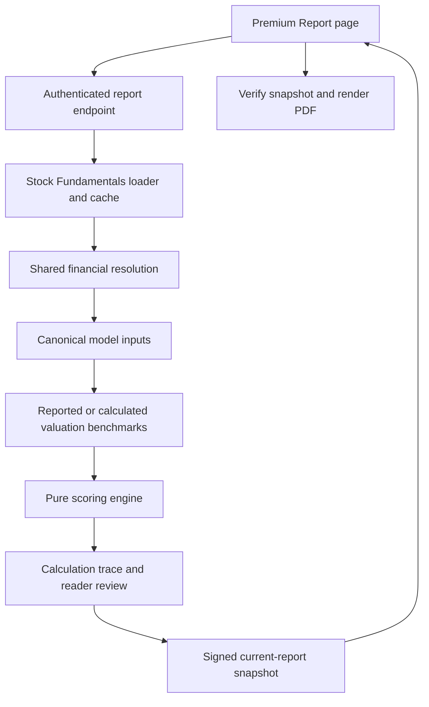

# Premium model implementation

This is the current engineering reference for FinLit's on-demand financial-health assessment. Read the [input/output contract](premium-model-input-output.md) for field definitions, request examples and result schemas, and [report lifecycle](premium-report-lifecycle.md) for deployment and snapshot handling.

The deterministic engine is **3.6.10**, derived from the supplied **3.6.1-simple** model plus the project-approved changes described below. Missing-data point estimates use the supplied **2026-10-14** group snapshot. These versions are defined in `backend/premium_model_config.py`. This implementation evaluates financial health; input coverage is not a measure of predictive accuracy or investment returns.

## Architecture and execution path



| Module | Responsibility |
| --- | --- |
| `backend/server.py` | Authenticated routes, exact company resolution, provider connectors, dashboard capture, bounded generation concurrency and HTTP responses. |
| `backend/financial_records.py` | Provider-neutral numeric/date parsing, row selection and the rupee-to-crore unit constant. No network or scoring dependencies. |
| `backend/premium_classification.py` | Profile extraction and deterministic model-group classification, independent of financial adaptation and provider I/O. |
| `backend/premium_provider.py` | Shared bounded provider/retry budget and the standalone FinEdge input loader used by tests/tools. |
| `backend/fundamental_resolution.py` | Shared dashboard/report field recovery, financial identities, Q4 recovery, compatible Upstox statement rows and complete price-series recovery. |
| `backend/financial_fields.py` | Shared aliases and precedence for annual P&L interest expense. |
| `backend/premium_data.py` | Pure date/basis/unit normalization into canonical financial inputs, provenance, risk observations and own-history valuation medians. No provider requests. |
| `backend/benchmark_resolution.py` | Select reported industry/sector benchmarks and preserve their true scope and provider. |
| `backend/premium_benchmarks.py` | Collect/cache peer observations, derive peer multiples through the canonical adapter, and coordinate reported-first report benchmarks. |
| `backend/premium_model_config.py` | Versions, weights, bounds, fill points, window sizes, loss caps and rating thresholds. This is the parameter source of truth. |
| `backend/premium_engine.py` | `score_company(inputs, group)`: pure calculation, with no network, database or clock access. |
| `backend/premium_service.py` | Orchestrate loading, adapting, benchmarking, scoring and construction of one report. Production supplies `dashboard_load`; the direct FinEdge loader is a lower-level test/tool path. |
| `backend/premium_trace.py` | Explain the values, point calculations, effective contributions and caps from the existing scoring run. |
| `backend/premium_completeness.py` | Identify missing dependencies and limited histories for factors actually present in the rating. It does not fetch or rescore. |
| `backend/premium_presentation.py` | Deterministic factor pros/cons, benchmark disclosures, reader notes and completeness summary. |
| `backend/premium_snapshot.py` | Sign and verify the exact current report for serverless-safe PDF download. |
| `backend/premium_pdf.py` | Render the verified snapshot, without provider fetches or recalculation. |
| `frontend/src/pages/PremiumReportPage.jsx` | Route and company-selection UI; delegates stateful workflow to the report hook and completed-report rendering to the detail component. |
| `frontend/src/hooks/usePremiumReport.js` | Current report state, debounced company suggestions, snapshot restoration, legacy polling/cancellation, generation, auth/error handling and download state. |
| `frontend/src/components/PremiumReportDetail.jsx` | Completed-report rendering, category reviews, financial history and existing chart layout, independent of report generation state. |
| `frontend/src/components/PremiumInputCompleteness.jsx` | Dedicated rendering of missing factors and short histories, including legacy-snapshot guidance. |
| `frontend/src/lib/premiumReportDownload.js` | Signed-snapshot/legacy PDF download requests and temporary anchor/object-URL cleanup, with no score calculations. |

## Data sourcing and financial definitions

Production reports call `_premium_dashboard_inputs`, which uses the same yearly and quarterly `_fetch_stock_fundamentals` results and captured rows as Stock Fundamentals. Financial resolution follows **FinEdge actual -> complete FinEdge calculation -> compatible Upstox observation -> unavailable**. Valuation *benchmarks* have their separate provider-first policy below.

- Existing reported amounts, including zero, win over derived or secondary values. Missing is `None`/JSON `null`; it is never silently converted to zero.
- Statements have one effective consolidated/standalone basis. If the dashboard resolves consolidated requests to standalone, the entire report uses and discloses that effective basis. Bank NPA disclosures may use the dashboard's explicitly labelled standalone disclosure fallback; this exception does not switch the other statements' basis.
- Monetary FinEdge statement amounts are converted from rupees to crore. Upstox financial amounts are accepted only for the requested basis and `units_in: "crore"`, then converted to the common raw representation. EPS remains rupees/share; price remains rupees/share; normalized shares are crore shares.
- Future statement/history observations, and filings with a known future publication date, are excluded. Quarterly durations are 70-105 days; annual durations are 330-400 days when start dates are supplied. Duplicate periods prefer the latest reported restatement. Missing calendar periods stay as holes in chronological arrays. Stale, future or unverified quote dates produce a separate data-integrity caution rather than silently changing metric points.
- The report uses the model names Sales streak, Sales growth and Sales CAGR across all groups; history tables and charts use Sales. This naming does not change the source-field mapping below.
- Non-financial income means operating revenue. BANK/NBFC income means net interest income, using explicit NII or interest earned minus explicit interest expense. INSURANCE income means net premium income. Generic Upstox revenue cannot replace NII or net premium income.
- Profit prefers owner-attributable earnings when reported, with the adapter's total-profit aliases used when a separate owner line is unavailable. Policyholder surplus is not a substitute for insurer shareholder profit.
- Book equity is **total equity including non-controlling interests**, matching the owner model. Parent equity plus minority interest requires both amounts. Bank capital plus reserves is accepted only when the balance-sheet identity reconciles. ROE/ROA use latest equity/assets as specified by the model, not the separately retained annual-matching diagnostics.
- EBITDA uses an explicit EBITDA field, EBIT plus depreciation, or PBT + finance cost + depreciation - other income with every component present. A generic provider operating-profit category is not assumed to be EBITDA.
- Shares prefer dated ownership data with share-count/market-cap checks. Depository receipts are included only when the share identity and market capitalization reconcile. This is relevant to P/B and enterprise value.

### Recovery rules

`derive_finedge` completes explicit same-period accounting identities: tax components, PBT minus tax, owner profit minus minority profit, assets/liabilities/equity components, borrowing components and EBITDA. Interest expense can be EBIT minus PBT, or lender interest earned minus NII, only with explicit compatible inputs and a non-negative result. Cash-flow interest payments are not P&L interest expense.

Four matching quarters can supply additive annual amounts when the annual row exists. A full-year amount minus its first three matching quarters can recover Q4, including an invalidly labelled Q4 row. EPS and balance-sheet stocks are not inferred by these additive identities. Annual depreciation can use the same-date cash-flow disclosure.

Upstox quarterly income recovery uses its grouped quarterly revenue/profit series. Its `full_statement` is treated as annual even on a quarterly request. Annual statements use the detailed annual lines; annual operating cash flow can also use the documented operating category. Partial balance sheets receive dated recovery checks and reject a mixed-source result that violates the accounting identity. Old annual balances never replace a later quarter.

Risk recovery accepts one complete exchange series: 251 positive closes, the latest 60 valid non-negative volumes, and a last observation no more than 10 calendar days old. Individual FinEdge/Upstox candles are not spliced. Exchange differences and unverified corporate-action adjustments remain disclosed limitations.

### Valuation benchmarks

For each comparison independently: **positive reported FinEdge industry benchmark -> positive reported Upstox sector benchmark -> calculated FinEdge peer median -> unavailable**. Upstox's sector scope is not relabelled industry in reader text. Its unspecified valuation date, statement basis and aggregation method remain disclosed.

Calculated peer medians require at least five positive observations. Partial peer coverage is allowed and labelled with observed/positive/universe counts. P/E and P/B peer universes are limited to 500; EV/EBITDA peer calculations apply to HEAVY/UTILITY with at most 100 peers. Provider observations and calculation attempts are cached for 15 minutes; missing fields remain explicit.

Own-history medians use eligible completed buckets within five years: quarter ends for P/E and half-year ends for P/B, using observations within 10 days of the bucket end. At least eight positive observations are required. An available industry/sector benchmark substitutes for missing own history under state `S`.

## Model groups and effective factors

Classification matches profile industry/sector text in this order: INSURANCE, NBFC, BANK, REALTY, UTILITY, HEAVY, LIGHT, then recognized manufacturing. Vehicle terms take manufacturing precedence over construction/utility terms, after the financial/real-estate checks. Unknown classifications default internally to MFG **with a rating blocker**; they do not receive a valid overall rating. There are no company-specific score overrides.

The eight groups are LIGHT, MFG, HEAVY, UTILITY, REALTY, BANK, NBFC and INSURANCE. Configured factor weights are **relative contributions**, normalized after applicability decisions; they are not all percentages summing to 100. For example, an eligible optional PEG adds a relative weight of 20 in several groups.

### Fundamental weights

| Group | Revenue streak | Profit streak | Revenue growth | Profit growth | Revenue CAGR | Profit CAGR | Additional factor |
| --- | ---: | ---: | ---: | ---: | ---: | ---: | --- |
| LIGHT / MFG / UTILITY | 20 | 20 | 8 | 10 | 12 | 15 | Margin change 15 |
| HEAVY | 10 | 10 | 10 | 15 | 15 | 20 | Margin change 20 |
| REALTY | 10 | 10 | 12 | 15 | 18 | 20 | Margin change 15 |
| BANK / NBFC | 20 | 20 | 6 | 10 | 9 | 15 | Loan growth 20 |
| INSURANCE | 20 | 20 | 8 | 8 | 12 | 12 | Net-worth growth 20 |

"Revenue" in this table uses the group-specific income definition above.

### Quality and Valuation weights

| Group | Quality | Valuation |
| --- | --- | --- |
| LIGHT | D/E 20; interest cover 20; ROE 35; cash conversion 25 | P/E industry 40; P/E history 30; PEG 30 |
| MFG | D/E 25; interest cover 25; ROE 30; cash conversion 20 | P/E industry 40; P/E history 30; PEG 30 |
| HEAVY | D/E 30; interest cover 30; ROE 20; cash conversion 20 | EV/EBITDA industry 40; P/B industry 30; P/E history 30; optional PEG 20 |
| UTILITY | D/E 25; interest cover 35; ROE 20; cash conversion 20 | P/B industry 35; EV/EBITDA industry 35; P/E industry 30; optional PEG 20 |
| REALTY | D/E 35; interest cover 25; ROE 20; cash conversion 20 | P/B industry 60; P/E industry 40; optional PEG 20 |
| BANK / NBFC | Gross NPA 25; net NPA 25; capital adequacy (interest-cover fallback) 25; ROA 25 | P/B industry 40; P/B history 30; P/E industry 30; optional PEG 20 |
| INSURANCE | Financial leverage 50; ROE 50 | P/B industry 50; P/E industry 25; P/B history 25; optional PEG 20 |

All groups use Risk weights: volatility 30, maximum fall 30, trading value 20, pledge 20. Higher Risk scores mean lower assessed risk.

The owner-confirmed 26 October changes restore capital adequacy as the primary BANK/NBFC Quality input, with interest cover (2x–8x) used only if capital adequacy is missing. The original capital-adequacy ranges remain BANK 12%–18%, NBFC 15%–25%. Explicit zero is available data and does not trigger fallback. INSURANCE uses financial leverage (assets / equity), replacing interest cover in its 50-point Quality slot; ROE retains the other 50. The supplied function scores <=5x at 100, >=20x at 0 and otherwise rounds `100 * (20 - leverage) / 15` to two decimals. Non-positive equity is invalid: the leverage factor is unscored, counts as unavailable in coverage, and is explicitly flagged rather than receiving a point estimate. The calibration range is provisional. Solvency is retained only as a diagnostic. BANK alone conditionally replaces an unavailable industry P/E slot with own P/E history, and an unavailable industry P/B slot with ROE. Replacements preserve the replaced slot's weight. A valid zero/loss score does not trigger a fallback.

## Calculations and scoring

Ordinary metric points are `clamp((value - worst) / (best - worst) * 100, 0, 100)`. Descending bounds reward lower values. All exact group ranges live in `GROUPS[group]["limits"]`; revenue/profit CAGR use their corresponding growth bounds.

Common bounds, expressed as **0-point value -> 100-point value**: relative P/E, P/B and EV/EBITDA 1.6x -> 0.6x; PEG 2.5 -> 0.5; cash conversion 0.4x -> 1.0x; volatility 55% -> 20%; maximum fall 50% -> 15%; pledged promoter shares 30% -> 0%. Trading value uses steps: at least ₹25/10/2/0.5/0 crore scores 100/80/60/30/0.

| Metric | Value calculation |
| --- | --- |
| Recent income / profit growth | Trailing four quarters versus the previous four when eight slots exist; otherwise latest quarter versus the same quarter a year earlier when five slots exist; otherwise latest annual versus previous annual. Incomplete chosen windows are not summed as partial results. Leading unreported slots are trimmed for these two growth factors; interior holes remain missing. |
| Income / profit CAGR | Prefer five years, then three, then the longest remaining available period (two or one years). Require consecutive annual observations ending at the latest financial year. `(latest / start) ** (1 / years) - 1`, expressed in percentage points. Four available years select the preferred three-year window. |
| Margin change | Difference between comparable current/prior EBITDA-to-revenue margins, expressed in percentage points. |
| Loan / net-worth growth | `(latest / matching balance one year earlier - 1) * 100`; the prior reporting month and day must match. |
| Debt / equity | Latest total borrowings / latest total book equity. |
| Interest cover | `(latest annual PBT + annual P&L interest expense) / interest expense`. Known zero expense has the model's special 100-point treatment; missing expense does not. Non-financial D/E below 0.1 makes this factor inapplicable. BANK/NBFC use this factor only when capital adequacy is unavailable. INSURANCE does not use interest cover. |
| ROE / ROA | Latest annual profit / latest total equity or assets, multiplied by 100. |
| Cash conversion | Sum of latest three annual operating cash flows / matching three annual profits, with all three periods present. |
| P/E | Price / sum of latest four quarterly EPS. When fewer than four EPS slots exist, use supplied trailing EPS then annual EPS. Four or more slots with an interior/latest missing EPS do not silently fall back to annual EPS. |
| P/B | Price * reconciled crore shares / latest book equity in crore. |
| EV/EBITDA | `(price * shares + debt - cash) / latest four-quarter EBITDA`, all monetary amounts in crore. |
| Relative valuation multiple | Company's calculated multiple / selected benchmark. A reported company ratio is not automatically substituted for the model's documented denominator. |
| PEG | Calculated P/E / positive profit growth capped at 40%. Prefer profit CAGR, otherwise recent profit growth. Core for LIGHT/MFG; other groups need at least six actual good profit quarters, subject to loss rules. |
| Volatility | Sample standard deviation of up to 250 daily returns * sqrt(250) * 100, with at least 60 valid returns. Invalid closes are not bridged. |
| Maximum fall | Largest close-to-running-peak decline over a complete 250-session window. |
| Trading value | Mean of close * volume over the latest 60 complete sessions, converted to crore. |
| Promoter pledge | Pledged promoter shares / total promoter shares * 100. Explicit no-pledge declarations and zero total promoter holding support zero; otherwise unknown remains missing. |

### Streaks and short histories

Use up to 14 quarterly slots, giving up to 10 year-on-year comparisons. A good sales quarter improves on the same quarter last year; a good profit quarter also has positive profit. Walk newest to oldest, allowing isolated failures; two consecutive failures end the growth run. Missing pairs are not counted as observed comparisons.

For `j` judged comparisons, `g` good quarters and `s` forgiven slips:

```text
base = max(0, 10*g - 5*s) * 10/j
magnitude = median growth points across good quarters
own = base * (0.8 + 0.2*magnitude/100)
credibility = j/10
points = own*credibility + fill*(1-credibility)
```

The coverage credit is `j/10`, so a valid value with a short history still reduces coverage. A current loss blends the profit streak with zero instead of the group fill. With a current loss and no judged profit quarters, the explicit loss-rule zero receives full rule-based coverage; the short history is still disclosed. Without that loss rule, no judged comparison is unavailable.

### Zero, negative and loss rules

- For a non-positive comparison base, a return to positive profit/income scores 70; a narrower remaining loss scores 30; otherwise zero. Latest non-positive profit forces recent profit-growth and profit-CAGR points to zero.
- A non-positive current operating margin with a valid comparison scores zero for margin change.
- Non-positive EPS, book equity or EBITDA uses the relevant zero-point valuation rule; it is not mistaken for a missing input.
- Three-year non-positive profit gives cash conversion 50 points when the matching operating cash flow is positive, otherwise zero. Both three-year totals must exist.
- Missing inputs use `FILL_OVERRIDES[group][metric]` or 50 points. These are the supplied snapshot's point estimates, not fabricated financial amounts or refreshed live medians.

### Category means, coverage and caps

Category score = sum of active factor weight * points / sum of active weights. `N` and `L` are excluded from its score denominator; `F` stays as an explicit estimate. Category coverage uses all applicable weights including `L`, with `F`/`L` receiving zero real-input credit and streaks their partial credit. `S` and valid special rules have real-input credit. Overall coverage = 0.40*Fundamental + 0.30*Valuation + 0.20*Quality + 0.10*Risk coverage.

Apply the Fundamental loss ceiling first:

| Family | Groups | Recovering | Current loss | Persistent loss | Chronic loss |
| --- | --- | ---: | ---: | ---: | ---: |
| Standard | LIGHT, MFG, UTILITY | 55 | 40 | 30 | 20 |
| Cyclical | HEAVY, REALTY | 60 | 45 | 30 | 20 |
| Financial | BANK, NBFC, INSURANCE | 50 | 35 | 25 | 15 |

Current loss uses the latest complete four-quarter profit, or latest annual profit when fewer than four quarterly slots exist. Persistent means at least two non-positive annual results in the last three; chronic means at least four in five, or all available annual results non-positive with at least three present. Recovering means positive current profit but a non-positive latest annual result or at least two non-positive results in the last three annual slots. A net loss at least 10% of current revenue reduces a current-loss ceiling by a further 10, with a floor of 10. A ceiling never raises a lower score.

After this, if Fundamental or Quality is below 35, cap Valuation at 60. The final score combines resulting categories with weights **40% Fundamental, 30% Valuation, 20% Quality, 10% Risk**. The internal adjustment records reconcile every cap's reduction in the final score.

Labels: >=80 STRONG; >=65 HEALTHY; >=50 AVERAGE; >=35 WEAK; otherwise POOR. Coverage below 50%, insufficient income history (neither four observed quarters nor two annual values), or a classification blocker gives NOT RATED and `final: null`. Otherwise coverage below 80% or fewer than six comparable quarters gives PROVISIONAL, whose label is capped at HEALTHY. Other results are RATED. `dataIntegrityStatus` separately indicates review cautions; a caution does not silently change the score.

## Presentation, completeness and validation

Reader pros are actual/substituted/rule-based factors with >=70 points; cons have <40; intermediate results are mixed. Estimated/unavailable factors are separate. Input completeness lists each unavailable factor's dependencies and periods, scoring estimate/exclusion, and short streak histories. Valid substitutions and true inapplicability do not count as unavailable. A 100% model coverage percentage does not promise that every unscored provider field exists.

The website and PDF show the same assessment and completeness details. Scoring weights, raw equations, input hashes and request diagnostics remain internal. The PDF ends with financial history and key ratios; there is no technical audit appendix. The signed snapshot includes an internal trace for engineering validation.

Run the relevant regression suites from the repository root:

```sh
PYTHONPATH=.:backend backend/.venv/bin/python -m pytest backend/tests/test_premium*.py backend/tests/test_required_input_recovery.py backend/tests/test_assessment_data_recovery.py backend/tests/test_fourth_quarter_recovery.py backend/tests/test_valuation_benchmarks.py backend/tests/test_flagged_company_lookup.py backend/tests/test_stock_fundamental_normalization.py
cd frontend
npm test -- --watchAll=false --runInBand src/components/PremiumReportDetail.test.jsx src/hooks/usePremiumReport.test.jsx src/lib/premiumReportDownload.test.js src/lib/premiumReportReview.test.js src/lib/currentPremiumReport.test.js src/lib/premiumReportPolling.test.js
```

Tests cover pure-engine parity, approved loss/CAGR/BANK rules, compatible source recovery, website/PDF content, signed snapshot integrity and serverless delivery. The small provider/reference fixtures under `backend/tests/fixtures` are deliberate regression inputs. Generated spreadsheets, database captures, screenshots and previews belong in ignored `output/`, `outputs/` or `tmp/`, not Git.

The boundaries are intentional: parsing/classification do not import the adapter or provider layer; the adapter does not perform I/O; benchmark collection may call the adapter and shared provider budget; the service coordinates these stages. On the frontend the page renders workflow state, the hook owns its transitions, and the detail view reads a completed snapshot. This keeps source recovery, numerical scoring and browser lifecycle changes independently reviewable.

When changing a formula, weight, classification policy or fallback: update configuration/engine, version the numerical change, update both technical references, and add a regression describing the intended financial behavior. A new provider alias needs evidence of its meaning, units, period and statement basis. Never tune scores to a reference total or conceal an unresolved input by assigning an invented amount.

## Additive ST/LT assessment

Premium Reports also include the scoring-only ST/LT v14.3 market assessment.
Its data, formulas, exclusions, missing-input behaviour and output contract are
documented in [premium-st-lt-model.md](premium-st-lt-model.md). The financial-health
engine and its score remain independent.

Insurance leverage follows the same source order as the dashboard: its captured FinEdge leverage ratio first, assets/equity calculated from a matched balance-sheet row next, then the captured Upstox ratio; otherwise unavailable. Known non-positive current equity overrides a stale reported ratio and is flagged. The calculated path uses the owner-supplied `insurance_leverage_score` function; reported ratios use its identical point mapping.
